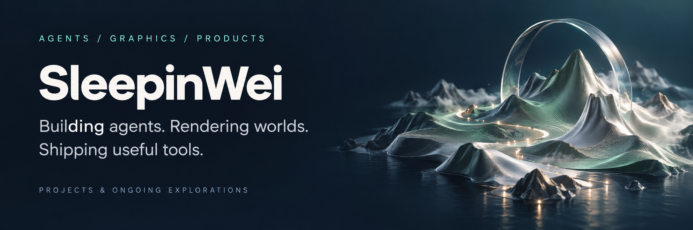

  

  <strong>Computer Science master's student at Tongji University · 2024–present</strong> 
  Exploring agent systems, computer graphics, and AI applications.

<!-- 

  <a href="#projects">Projects</a> &nbsp;·&nbsp;
  <a href="https://sleepinwei.github.io/ValleyTown/">Visit ValleyTown ↗</a>

 -->

## Projects

### Jev LongSeq · Browser agents for long tasks

An evidence-grounded browser agent that combines **LLM planning with Jev action selection**. It breaks work into stages, tracks progress across pages, and reads back changes to verify what actually happened.

- **Plan, act, verify:** event-driven replanning, task contracts, and source-linked memory.
- **Inspect the run:** Trace Studio for browser replay, decisions, and model usage.
- **Improve with evidence:** evaluation tooling and an autoresearch loop for testing individual changes.

`Python` `Playwright` `BrowserGym` `Agent Evaluation`

**[Explore the repository →](https://github.com/SleepinWei/Jev-LongSeq)**

<table>
  <tr>
    <td width="50%" valign="top">
      <h3>ValleyTown</h3>
      
      
<strong>A shared world, with individual stories.</strong>

      
An HD-2D agent town with 24 residents, individual memories, and evolving relationships. Visitors watch the same world; an administrator's browser runs the simulation.

      
Day–night cycles, changing weather, and resident stories make agent behavior something you can explore.

      
<code>TypeScript</code> <code>React</code> <code>Three.js</code> <code>Supabase</code>

      
<a href="https://sleepinwei.github.io/ValleyTown/"><strong>Live demo ↗</strong></a> · <a href="https://github.com/SleepinWei/ValleyTown">Repository</a>

    </td>
    <td width="50%" valign="top">
      <h3>Scene Renderer</h3>
      
      
<strong>Real-time worlds and offline light transport.</strong>

      
A C++17 renderer with native Metal and Vulkan backends, a shared RHI, and a common GLSL shader pipeline. Immutable scene snapshots connect the logic and render threads.

      
PBR, CSM/PCSS soft shadows, atmospheric scattering, 3D voxel clouds, FFT oceans, and virtual-textured terrain with vegetation.

      
CPU/Metal/Vulkan path tracing adds textured materials, refraction, and medium scattering; CPU BDPT renders glass caustics, with optional OIDN denoising.

      
<code>C++17</code> <code>Metal</code> <code>Vulkan</code> <code>GLSL</code> <code>Path Tracing</code>

      
<a href="https://github.com/SleepinWei/Scene-Renderer"><strong>Repository →</strong></a> · <a href="https://github.com/SleepinWei/Scene-Renderer/blob/main/docs/rendering-gallery.md">Gallery</a> · <a href="https://github.com/SleepinWei/Scene-Renderer/blob/main/docs/system-design.md">System design</a> Started as a team project for Tongji University's Computer Graphics course; expanded through continued iteration.

    </td>
  </tr>
</table>

### ARC Agent / Octos Harness

**Making coding agents easier to measure and improve.** Extends the Octos harness with execution traces, diagnostics, budget tracking, and an autoresearch controller. Candidate changes are compared through controlled experiments and independent acceptance checks, with the aim of reducing token usage and latency while preserving task correctness.

`Python` `Agent Harnesses` `Observability` `Autoresearch`

### LedgerAsk

**From trade documents to a reviewable ledger.** A commodity trade ledger application with invoice uploads, OCR, human review and confirmation, and ledger exports. Multi-tenant roles, private attachments, and durable background jobs support the workflow from document intake to structured records.

`Next.js` `TypeScript` `FastAPI` `PostgreSQL` `OCR`

**[Visit LedgerAsk ↗](https://1000flow.com)**

### More Experiments

| Project | What it does |
| --- | --- |
| **MemoryBridge** | A private, collaborative memory map for close friends. Combines photos, places, dates, and stories into shared memory Pins, with reviewable AI suggestions. Built with Expo and React Native for OpenAI Build Week. |
| **WeChat Notify Bridge** | Connects phone notifications to a desktop workflow studio, with visual editing for business process steps, conditions, and reminders. |

## Toolbox

| Area | Tools I use across these projects |
| --- | --- |
| **Agents & AI** | Python · Playwright · BrowserGym · MCP · model APIs |
| **Graphics** | C++17 · Metal · Vulkan · OpenGL · GLSL · Three.js |
| **Web & Mobile** | TypeScript · React · Next.js · Expo · React Native |
| **Data & Services** | FastAPI · PostgreSQL · Supabase |

---

From execution traces to rendered scenes — building things I can inspect, understand, and keep improving.

<!--START_SECTION:waka-->
<!--END_SECTION:waka-->
